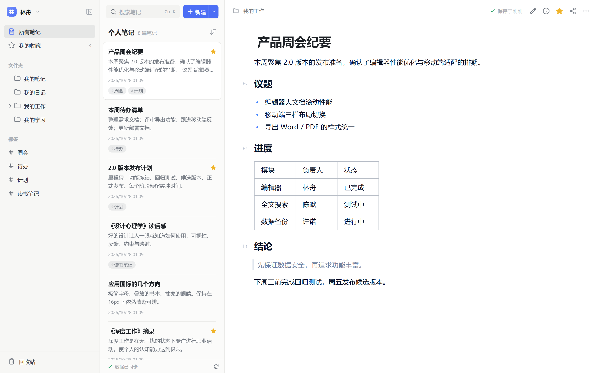
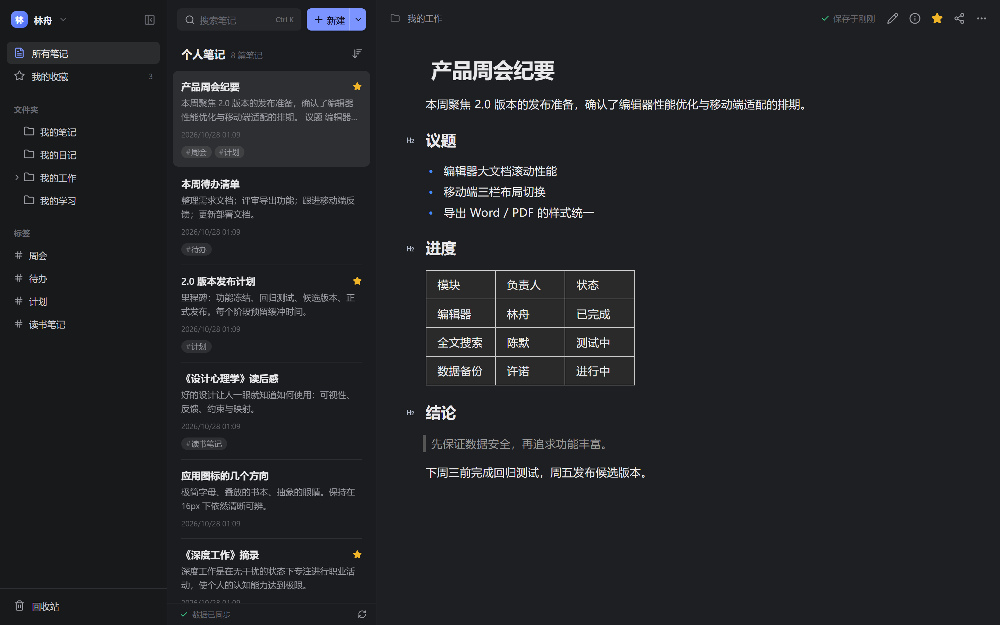
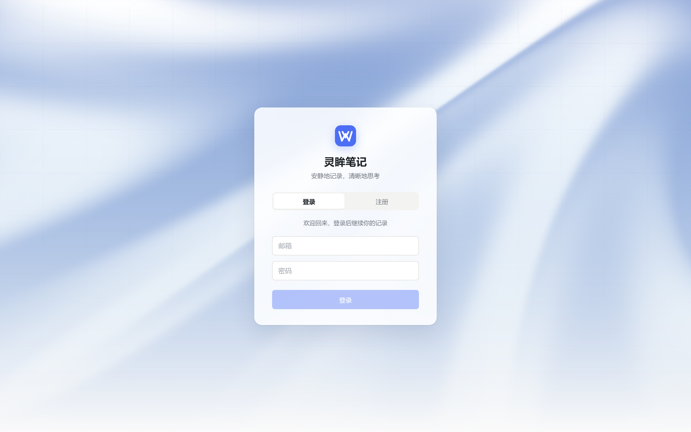
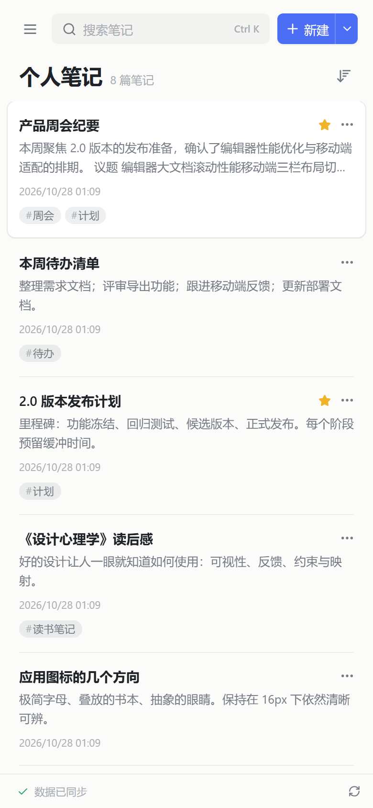
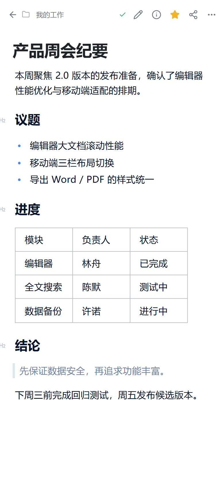

<p align="center">
  
</p>

<h1 align="center">灵眸笔记 WixNote</h1>

<p align="center">安静地记录，清晰地思考 —— 自托管、单容器的私人笔记服务</p>

<p align="center">
  <a href="https://ikiwihome.github.io/wixnote/"><strong>项目主页</strong></a> ·
  <a href="#快速开始">快速开始</a> ·
  <a href="README.en.md">English</a>
</p>

<p align="center">
  
  
  
  
</p>



灵眸笔记是一个简洁的私人笔记应用：富文本与大纲编辑、全文搜索、历史版本、多格式导出一应俱全，笔记数据始终留在你自己的服务器上。

它基于 React + Express + SQLite 构建，整套服务打包为**单个容器镜像**，不需要外部数据库、Redis 或搜索集群，一条 `docker compose` 命令即可运行。

## 界面截图

<table>
  <tr>
    <td width="50%"></td>
    <td width="50%"></td>
  </tr>
  <tr>
    <td align="center">深色模式</td>
    <td align="center">登录界面</td>
  </tr>
</table>

<p align="center">
  
  &nbsp;&nbsp;
  
</p>
<p align="center">移动端</p>

## 功能特性

**编辑与组织**

- 富文本与大纲笔记：标题、列表、待办清单、表格、代码块、图片与附件，支持插入流程图 / UML。
- 5 个内置模板：空白、会议纪要、每日日记、读书笔记、项目计划；可导入 Markdown 文件为新笔记。
- 多级文件夹、标签与收藏；按修改时间、创建时间或标题排序，摘要 / 紧凑两种列表视图。

**查找与回溯**

- 中文标题与正文全文搜索，`Ctrl/⌘ + K` 随时唤起。
- 点击保存图标或按 `Ctrl/⌘ + S` 保存；未保存的草稿留在当前浏览器中，刷新后可恢复。
- 历史版本查看与恢复、回收站、多窗口编辑冲突提示。

**分享与导出**

- 只读链接分享与撤销，个人笔记评论。
- 导出 Word、PDF、HTML、Markdown 和纯文本。
- JSON 完整备份与追加式恢复。

**体验与安全**

- 浅色 / 深色 / 跟随系统主题，可调字号，专注模式，手机端单栏导航。
- 多账户数据隔离，首个账户创建后默认关闭注册，没有默认密码。
- 容器以非 root 用户、只读根文件系统运行。

## 快速开始

### 使用 Docker Compose（推荐）

要求 Docker Engine / Docker Desktop 与 Docker Compose v2。

```sh
git clone https://github.com/ikiwihome/wixnote.git
cd wixnote
docker compose up -d --build
```

打开 <http://localhost:8080> 创建第一个账户。没有默认密码，密码至少 10 位；首个账户创建后注册默认关闭。

```sh
docker compose ps
docker compose logs -f --tail=100
```

笔记、历史版本、评论与附件保存在命名数据卷 `wixnote-data` 中，重建容器不会丢失。Compose 默认使用非 root 用户、只读根文件系统、`cap_drop: ALL`、健康检查与 `unless-stopped` 重启策略。

停止服务使用 `docker compose down`；`docker compose down -v` 会一并删除数据卷。

### 直接使用 Docker

```sh
docker build -t wixnote:local .
docker run -d --name wixnote --restart unless-stopped \
  -p 8080:3000 -v wixnote-data:/data wixnote:local
```

容器内服务固定监听 `3000`，数据目录为 `/data`。

### 首次登录

1. 打开首页，用邮箱 + 姓名 + 至少 10 位密码注册首个账户。
2. 首个账户创建后 `ALLOW_REGISTRATION=false` 生效；其他用户需管理员放开该开关后再注册。
3. 各账户的文件夹、标签、笔记与附件互相隔离。

## 配置项

复制 `.env.example` 为 `.env` 后调整，再运行 `docker compose up -d --build`。

| 变量                 | 默认值                     | 说明                                                    |
| -------------------- | -------------------------- | ------------------------------------------------------- |
| `PORT`               | `8080`                     | Compose 映射的宿主机端口（容器内始终是 `3000`）         |
| `HOST`               | `0.0.0.0`                  | 服务监听地址                                            |
| `DATA_DIR`           | `./data`（镜像内 `/data`） | SQLite 数据库与附件目录                                 |
| `MAX_UPLOAD_MB`      | `100`                      | 单个附件与解压后 ZIP 资源大小上限，取值 1–1024          |
| `ALLOW_REGISTRATION` | `false`                    | 首个账户之后是否允许继续注册                            |
| `SECURE_COOKIE`      | `false`                    | 通过 HTTPS 访问时设为 `true`，会话 Cookie 将带 `Secure` |
| `CHROMIUM_PATH`      | 自动查找                   | PDF 导出所用 Chromium 或 Chrome 可执行文件的路径        |
| `WIX_RESET_PASSWORD` | 空                         | 仅用于密码重置脚本的非交互模式                          |

希望使用宿主机目录时，把 Compose 的卷映射改成 `./data:/data`；Linux 上该目录需允许 UID/GID `1000:1000` 读写。

## 本地开发

需要 Node.js 24.22.1 或更高版本、pnpm 12.3.4，无需 Docker：

直接导出 PDF 还需要安装 Chromium 或 Chrome 及中文字体；如未自动找到浏览器，请设置 `CHROMIUM_PATH`。Docker 镜像已包含 Chromium 和中文字体。

```sh
npm install --global pnpm@12.3.4
pnpm install --frozen-lockfile --ignore-scripts
pnpm run dev
```

- 前端开发页面：<http://localhost:5173>（Vite，`/api` 与 `/files` 代理到 3000）
- API / 后端：<http://localhost:3000>
- 本地数据库默认写入 `data/`

若 3000 端口已被生产预览占用，请先停止该进程。

生产模式：

```sh
pnpm run build
pnpm start
# http://localhost:3000
```

## 测试与验证

```sh
pnpm run lint                          # JavaScript / React、CSS 与格式检查
pnpm run lint:js                       # ESLint（包含 React Hooks 检查）
pnpm run lint:css                      # Stylelint
pnpm run format                       # 统一格式
pnpm test                             # 存在 tests/*.test.js 时执行
pnpm run build                          # 生产构建
curl http://localhost:3000/api/health  # 返回 {"ok":true,...}
```

## 数据与备份

### 数据目录

```text
data/
├── wixnote.sqlite        # 账户、会话、文件夹、标签、笔记、历史、评论、附件元数据
├── wixnote.sqlite-wal    # WAL 文件（运行时存在）
├── wixnote.sqlite-shm    # 共享内存文件（运行时存在）
├── attachments/          # 附件二进制，按附件 ID 命名
└── .uploads/             # 上传临时目录
```

账号与会话也在数据库内，恢复数据库即恢复了登录状态。

### 应用内 JSON 备份

在「设置 → 数据管理」中导出 JSON，内容包含文件夹、笔记原生块、标签、评论、历史与附件（附件以 base64 内嵌）。导入为**追加**模式：重新映射 ID 后插入，不覆盖已有内容。

限制：单次备份的附件总量上限 100 MB，序列化后 JSON 上限 150 MB，超出时请改用数据目录备份。

### 数据目录备份（推荐用于大规模数据）

```sh
docker compose stop
docker compose cp wixnote:/data ./wixnote-data-backup
docker compose start
```

还原时先停止服务，把备份放回数据卷或挂载目录，确保 UID/GID `1000:1000` 可写。SQLite 文件与 `attachments/` 必须作为同一次备份一起还原。

### 重置密码

在宿主机管理终端执行，按提示交互输入新密码（已有登录会话会被撤销）：

```sh
docker compose exec wixnote node scripts/reset-password.js you@example.com
```

非容器环境：

```sh
DATA_DIR=./data node scripts/reset-password.js you@example.com

# 非交互（CI / 容器）：
WIX_RESET_PASSWORD='new-password-123' node scripts/reset-password.js you@example.com
```

该命令只读写本地数据库，不会发邮件或连接官方服务器。

## 部署到公网

反向代理到宿主机 `8080`（或容器 `3000`），保持同源即可；本实现不需要额外 UDP 端口。

```nginx
server {
    listen 443 ssl;
    server_name notes.example.com;
    # ssl_certificate / ssl_certificate_key 按自己的证书配置

    client_max_body_size 160m;

    location / {
        proxy_pass http://127.0.0.1:8080;
        proxy_set_header Host $host;
        proxy_set_header X-Forwarded-Proto $scheme;
        proxy_set_header X-Forwarded-For $proxy_add_x_forwarded_for;
        proxy_read_timeout 120s;
    }
}
```

启用 HTTPS 后务必设置 `SECURE_COOKIE=true`。分享链接使用浏览器访问地址生成；图片以内联方式返回，其他附件强制下载。

`client_max_body_size` 需覆盖 JSON 备份导入（上限 150 MB）与附件上传。

## 项目结构

```text
.
├── src/                     # React 前端
│   ├── App.jsx              # 布局、列表、对话框、快捷键
│   ├── Editor.jsx           # 编辑器宿主，postMessage 桥接 iframe
│   ├── editor/              # 从 wiz-editor/client 导入的编辑页适配及初始化脚本
│   ├── api.js               # fetch 封装与格式化工具
│   ├── components.jsx       # 通用组件与内置模板
│   └── style.css
├── server/
│   ├── index.js             # Express 应用、全部 REST 路由、安全中间件
│   ├── db.js                # node:sqlite 打开与 schema 迁移
│   ├── document.js          # 原生编辑器块校验与资源路径重写
│   └── zip.js               # ZIP 读写
├── public/
│   ├── editor/              # 编辑器隔离页、样式与许可声明
│   └── assets/
├── scripts/
│   ├── dev.js               # 同时启动后端与 Vite
│   ├── e2e-server.js        # 使用临时数据目录的测试服务器
│   └── reset-password.js
├── docs/                    # 项目主页（GitHub Pages）与截图
├── .github/workflows/       # 构建、E2E 与容器冒烟测试
├── compose.yaml
├── Dockerfile
└── playwright.config.js
```

## 贡献

1. Fork 仓库并从 `main` 创建分支。
2. 保持既有代码风格：`npx prettier --write .`（配置见 `.prettierrc.json`）。
3. 提交前至少运行 `npm run build`；涉及编辑器、上传、备份的改动请做一次手工回归。
4. 提交 Pull Request，说明动机、行为变化与验证步骤。

## 许可证

[MIT](LICENSE)
